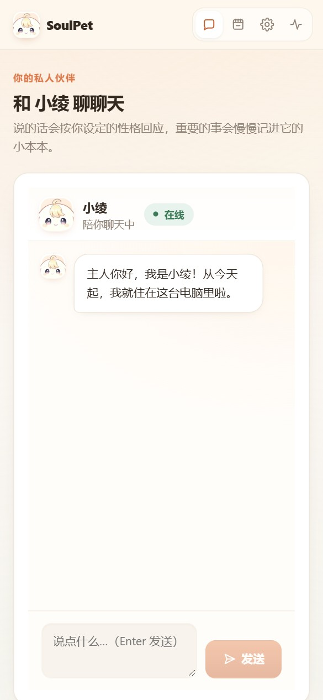

# SoulPet · 私有 AI 宠物

> 双击启动脚本 → 浏览器弹出向导 → 捏一只属于你的 AI 宠物。
> **配置、记忆、密钥、素材全部保存在你自己的机器（或你自己的云服务器）上，不上传任何第三方。**

[English](#english) · [完整使用手册](docs/USAGE.md) · [特性](#特性) · [快速开始](#快速开始) · [目录结构](#目录结构) · [隐私与安全](#隐私与安全) · [QQ 连接器](#qq-连接器) · [常见问题](#常见问题)


> 分步可视化向导，右边那只兔子「向导小灵」会跟着你当前在哪一步换台词和表情（12 张立绘、9 种情绪）；
> 填错了它会变慌张脸，点它一下能重播这句话。
> 更多截图见 [使用手册](docs/USAGE.md)。

---

## 特性

| | |
|---|---|
| 🧙 **可视化向导** | 捏宠向导：形象 → 性格（五维滑块）→ 部署方式 → 模型 → 模块开关 → 确认生成（按开关 7~9 步） |
| 🔒 **本地优先** | SQLite + JSONL 全在本机；密钥进系统钥匙串；除你主动配置的 LLM 与 QQ 外不联网 |
| 🧠 **三层记忆** | 工作记忆 / 事件记忆 / 摘要；带重要度、时间衰减、置顶、遗忘、导出导入 |
| 📈 **记忆时间线** | 按天可视化，可按类型筛选、搜索、编辑、置顶、遗忘 |
| 💰 **费用可控** | Token 计量 + 日提醒 + 月上限 + 到顶自动待机 |
| 🔌 **模块可插拔** | QQ 连接器 / 桌面桌宠 独立开关，崩了不影响网页聊天 |
| 🎨 **零成本先体验** | 不填 API Key 也能用内置「离线体验模式」跑通全流程 |
| 🖥️ **一键启动** | `start.bat` / `start.sh` 自动建虚拟环境、装依赖、顺延端口、开浏览器 |
| 🛡️ **自检可回归** | 33 个后端测试 + 41 项真浏览器 UI 冒烟，CI 在三大系统 × 三个 Python 版本上跑 |

---

## 快速开始

### Windows

```
双击 start.bat
```

### macOS / Linux

```bash
chmod +x start.sh && ./start.sh
```

脚本会自动：探测 Python 3.11+ → 创建 `.venv` 并装依赖 → 端口被占自动顺延 → 拉起服务 → 自动打开浏览器。

停止：`stop.bat` / `./stop.sh`，或直接关掉启动窗口。

### 手动启动（开发）

```bash
pip install -r requirements.txt
python launcher/launcher.py --port 8787     # 加 --reload 开启热重载
# 前端开发（另开一个终端）
cd frontend && npm install && npm run dev   # http://127.0.0.1:5173
```

> 首次打开若提示「前端尚未构建」，执行 `cd frontend && npm install && npm run build` 即可。

**下载后先看一眼**：GitHub 上的「Download ZIP」解压出来是 `soulpet-main/`（或 `lckk282-soulpet-<hash>/`），和文档里讲的 `soulpet/` 是同一个文件夹，改名不改名都能跑。仓库里已带构建好的 `frontend/dist/`，所以**不装 Node.js 也能直接双击运行**。

### 前置条件

- Python **3.11+**（Windows 安装时勾选 Add Python to PATH）
- 可选：大模型 API Key（任意 OpenAI 兼容端点：智谱 GLM / 通义千问 / DeepSeek / OpenAI / 本地 Ollama / 聚合网关）

> 每一步的界面细节、每个字段怎么填、报错怎么处理，都在 **[docs/USAGE.md](docs/USAGE.md)** 里。

---

## 捏宠九步

| 步骤 | 你会做什么 | 落盘配置 |
|---|---|---|
| 0 欢迎 | 三项知情确认（数据、费用、风险） | `config/global.yaml` |
| 1 形象 | 名字、身份预设（女仆/沉默NPC/活泼搭子/清冷助手/毒舌猫系/温柔学长学姐）+ 自定义、素材包 | `config/pet.profile.yaml` |
| 2 性格 | 粘人/话量/吐槽/情绪/记性 五维滑块 + 性格标签 + 作息（12h 活跃 / 12h 待机）+ 红线规则 | `pet.profile.yaml` + `config/schedule.yaml` |
| 3 部署 | 本地 或 云服务器（填主机/用户/目录，不会自动改动你的服务器） | `config/deploy.yaml` |
| 4 模型 | 选服务商、填模型名与 API Key、连通测试、单价与预算 | `config/model.yaml` + `config/pricing.yaml` |
| 5 模块 | QQ 连接器 / 桌面桌宠 两个独立开关 | `config/modules.yaml` |
| 6 QQ（分支） | 三选一方案 + 群白名单 + 风险确认 | `config/qq.yaml` |
| 7 桌宠（分支） | 素材包完整性校验（9 槽位）+ 动作预览 | `modules.yaml` |
| 8 确认 | 汇总清单 → 一键生成 → 跳转聊天页 | 全部配置 + `data/soulpet.db` |

性格不是直接把数字丢给模型，而是映射为**自然语言描述 + 采样参数**（`temperature` ≤ 0.95、`max_tokens` 180–800）、**行为参数**（主动消息频率、记忆写入阈值、检索 TopK）。映射表在 `backend/core/prompt_builder.py`，可以自己调。

---

## 目录结构

```
soulpet/
├─ start.bat / stop.bat          # Windows 一键启停
├─ start.sh  / stop.sh           # macOS / Linux 一键启停
├─ requirements.txt              # 核心依赖（约 40MB）
├─ requirements-qq.txt           # QQ 连接器可选依赖（websockets）
├─ docs/
│  ├─ USAGE.md                   # ★ 完整使用手册
│  └─ images/                    # 手册配图
├─ launcher/launcher.py          # 环境探测 / 端口顺延 / 等健康 / 开浏览器
├─ backend/
│  ├─ main.py                    # FastAPI 装配 + 口令闸门 + 静态托管 + lifespan
│  ├─ auth.py                    # 云服访问口令（Cookie / Bearer）
│  ├─ schemas.py                 # ★ 配置与 API 的全部数据模型（地基）
│  ├─ config_store.py            # YAML 原子写 + 自动备份 + 坏配置回退
│  ├─ secrets_store.py           # 钥匙串 / 加密文件降级
│  ├─ db.py / models.py          # SQLite（WAL）+ ORM
│  ├─ api/                       # wizard / chat / memory / model / modules / pet / status
│  ├─ core/                      # prompt_builder / pet_runtime / memory_engine /
│  │                             # memory_extractor / scheduler / usage_meter / event_bus
│  ├─ adapters/llm/              # OpenAI 兼容适配器 + 内置离线 Mock
│  ├─ adapters/qq/               # BridgeAdapter 抽象 + NapCat(OneBot11) + 独立桥接进程
│  └─ services/                  # module_manager / asset_pack / llm 工厂
├─ frontend/                     # Vue 3 + Vite + TypeScript
├─ deploy/                       # Dockerfile / docker-compose / nginx / init-certs.sh
│  └─ README.md                  # 云服务器部署说明
├─ tests/                        # pytest 后端冒烟 + ui_smoke.py 真浏览器冒烟
└─ data/                         # 运行数据（已 gitignore）
   ├─ soulpet.db  ├─ memory/*.jsonl  ├─ assets/  ├─ logs/  └─ backups/
```

---

## 隐私与安全

**承诺**：除你主动配置的模型厂商与 QQ 通道外，程序不向任何第三方发起请求。

具体做法：

1. **密钥不进配置文件**：`config/*.yaml` 里只有 `keyring://soulpet/llm_api_key` 这样的引用；真值存 Windows 凭据管理器 / macOS Keychain / Linux Secret Service；无图形环境时降级为 `data/secrets.enc`（PBKDF2 + AES-GCM，需设置 `SOULPET_MASTER_KEY`；两者都没有时会**在日志和界面上明确警告「明文存放」**，不假装已加密）。
2. **草稿不存密钥**：向导草稿（localStorage + `data/wizard_draft.json`）会把所有密钥字段整条删掉（不是填 `***` 占位符），有测试覆盖。
3. **日志脱敏**：不打印完整请求体，Key 一律 `***` 形式。
4. **默认只听本机**：服务绑定 `127.0.0.1`；CORS 只放行本地开发端口，浏览器里任意网站**读不到**你的 API。
5. **公网必须带口令**：`deploy.mode = cloud`（或设了 `SOULPET_ACCESS_TOKEN`）时，所有 `/api/*` 强制校验口令（Cookie 或 `Authorization: Bearer`），`/healthz` 单独放行给容器探针。
6. **数据可带走**：`设置 → 立即备份` 打包 config + 数据库 + 记忆；数据库走 SQLite 在线备份接口取一致性快照（WAL 下直接拷文件会漏数据）。
7. **图集生成的例外**：如果你将来使用「云端绘图生成形象」，参考图会发送给绘图服务商 —— 届时会二次确认，并且本项目**不中转、不保存**你的图片。当前版本的内置形象是本地 SVG 生成，不涉及任何上传。

---

## QQ 连接器

三种方案，按难度分层（**请务必阅读风险**）：

| 方案 | 难度 | 性质 | 说明 |
|---|---|---|---|
| **NapCat / Lagrange**（推荐） | ★★☆ | 第三方协议实现 | 生态成熟、教程多；支持图片/表情/群白名单。只与你自己部署的 NapCat 通过 OneBot11 通信 |
| 官方开放平台机器人 | ★★★ | 腾讯官方，合规 | 风控最低，但需资质申请与审核，有频率与功能限制 |
| Lite 协议 | ★☆☆ | **非官方逆向协议** | **违反 QQ 用户协议**，可能限制账号功能。本项目只保留配置位，**不实现、不分发任何协议代码**；启用后强制低频、禁主动消息 |

内置风控闸门（`backend/adapters/qq/base.py`）：

- 群白名单**默认拒绝**，未配置的群一律不回
- 触发模式：`@ 才回` / `关键词` / `全部回复`（默认 @）
- 频控：群 3 秒 1 条、全局 1 小时 200 条；静默时段不主动发消息
- 连续失败 5 次自动熔断 15 分钟
- 设置页有一键「断开 QQ」

启用：

```bash
pip install -r requirements-qq.txt
# 自行部署并登录 NapCat，然后在向导里填 ws://127.0.0.1:3001 与 token
```

> ⚠️ NapCat 的 WebSocket 端口**绝不能暴露到公网**。Docker 部署请写成 `127.0.0.1:3001:3001`。

---

## 云服务器部署（可选）

完整步骤见 **[deploy/README.md](deploy/README.md)**，三步概览：

```bash
cd deploy
cp .env.example .env && vim .env      # 必须改 SOULPET_MASTER_KEY 和 SOULPET_ACCESS_TOKEN
./init-certs.sh                       # 有域名签 Let's Encrypt，没域名加 --self 自签
docker compose up -d
```

- 访问方式：`https://你的域名/?token=<你在 .env 里设的口令>`，登录一次后 30 天免密
- 容器只监听回环，对外全靠 nginx 反代；nginx 已关掉 `proxy_buffering`，打字机不会被缓冲
- 记得在云厂商控制台放行 80/443

---

## 常见问题

**Q：没有 API Key 能用吗？**
能。向导模型页点「用离线体验」，会用内置离线回复跑通全流程，之后在设置里补 Key 即可。

**Q：端口被占用怎么办？**
启动器自动顺延（8787 → 8788 → …）并写回配置，无需手动处理。

**Q：换电脑 / 重装系统怎么迁移？**
`设置 → 立即备份` 拿到 zip，在新机器解压覆盖 `config/` 与 `data/` 即可。

**Q：它记错了怎么办？**
记忆时间线里可以编辑、置顶、遗忘，也可以整份清空。详见 [使用手册 第 7 章](docs/USAGE.md#7-记忆是怎么工作的)。

**Q：会不会很烧钱？**
默认每条消息有预算闸门。不填单价时费用统计不可用（不影响使用）；填了单价后超月上限会进入省钱待机。

**Q：SQLite 会不会撑不住？**
个人使用量级（<10 万条记忆）完全没问题。服务强制单 worker，已开 WAL。

**Q：手机上能用吗？**
能。同一个局域网里用手机访问 `http://电脑IP:8787` 即可（需要把 `--host` 设为 `0.0.0.0`，并建议同时设 `SOULPET_ACCESS_TOKEN`）。



**Q：还没走完向导就点了「聊天」？**
会看到一个「还没有宠物 → 去创造向导」的引导卡片，不会给你一个发了报错的输入框。两分钟填完就能聊。

**Q：捏完之后再打开，会不会让我重走一遍向导？**
不会。已经捏好了就直接落到聊天页。想重新捏，走「设置 → 重新运行创造向导」，聊天记录和记忆都保留。

---

## 开发

```bash
pip install -r requirements.txt -r requirements-dev.txt

pytest -q                          # 后端冒烟，离线可跑，使用临时数据目录
ruff check backend launcher tests  # 代码检查
ruff format --check backend launcher tests   # 格式检查

# 真浏览器端到端（自带一个临时实例，从零捏宠 → 提交 → 聊天）
python -m playwright install chromium
python tests/ui_smoke.py           # 加 --headed 可以看着它点
```

测试会用 `SOULPET_HOME` 指向临时目录，**不会碰你的真实数据**。

CI 在 ubuntu / windows / macos × Python 3.11 / 3.12 / 3.13 上跑后端测试，另有独立的 UI 冒烟任务。

---

## 路线图

- [x] 向导九步 + 配置生成 + 记忆系统 + 费用统计 + 运行状态
- [x] 访问口令闸门 + CORS 收紧 + 一致性备份
- [ ] 桌面悬浮桌宠（Tauri，订阅 `/api/status/events` 事件流）
- [ ] 九宫格图集生成器（云端 / 本地 ComfyUI 双路线）
- [ ] 云服务器一键部署向导（SSH 渲染 compose 并 apply）
- [ ] 主动消息与自动浏览订阅源
- [ ] 多宠物支持

---

## English

SoulPet is a **local-first** AI pet you create through a browser wizard. All configuration, memories, API keys and assets stay on your own machine or your own server — nothing is uploaded to a third party.

```bash
./start.sh        # macOS / Linux
start.bat         # Windows
```

Core stack: Python 3.11+ / FastAPI / SQLite (WAL) / Vue 3 + Vite. Any OpenAI-compatible LLM endpoint is supported, and there is a built-in offline mode so you can try everything without an API key.

---

## 许可

[MIT](LICENSE) © SoulPet contributors

> 使用 QQ 相关功能时请自行评估并承担账号风险；本项目仅供个人学习与自用娱乐，不提供任何担保。
