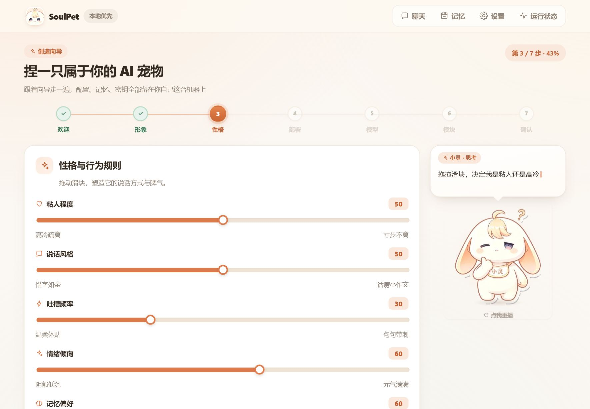
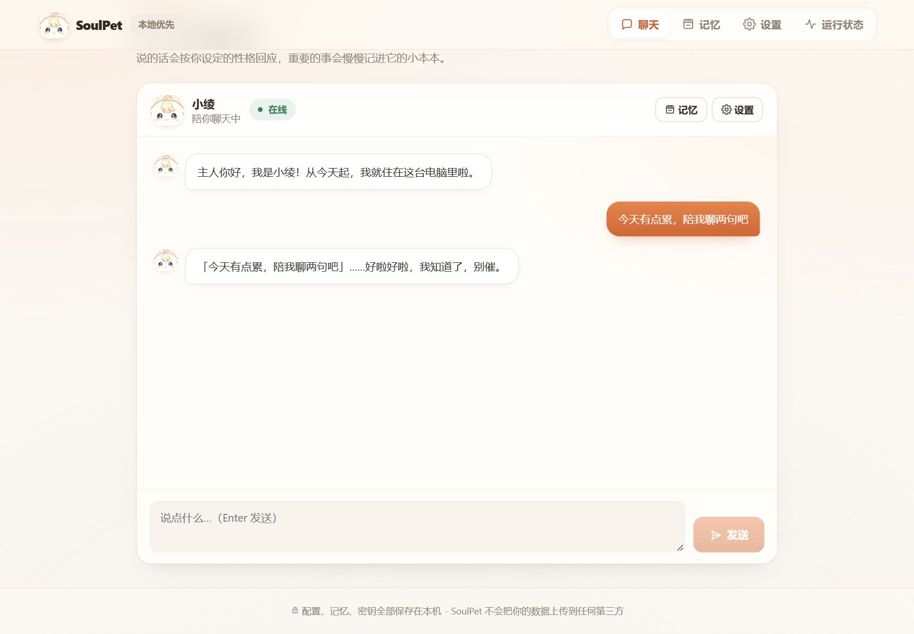
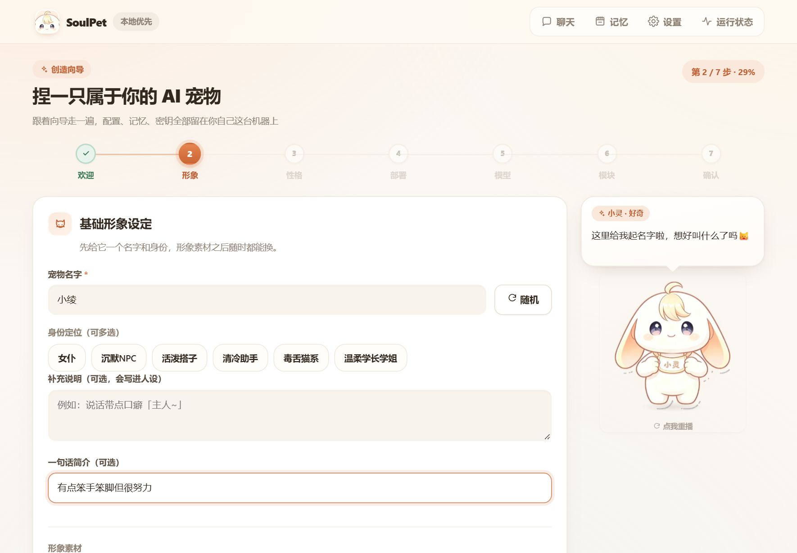
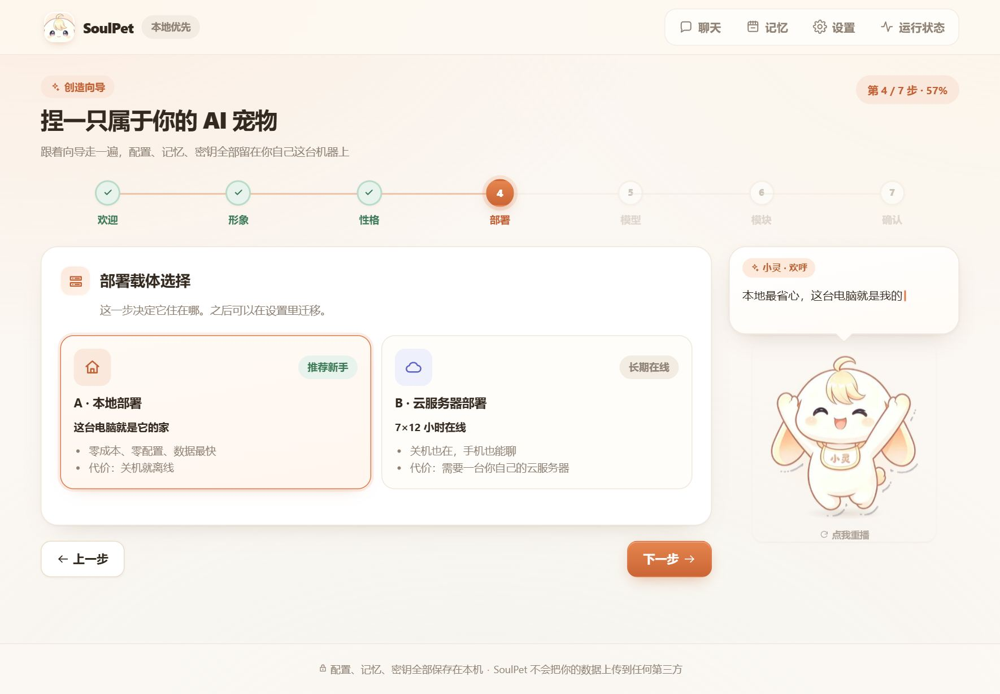
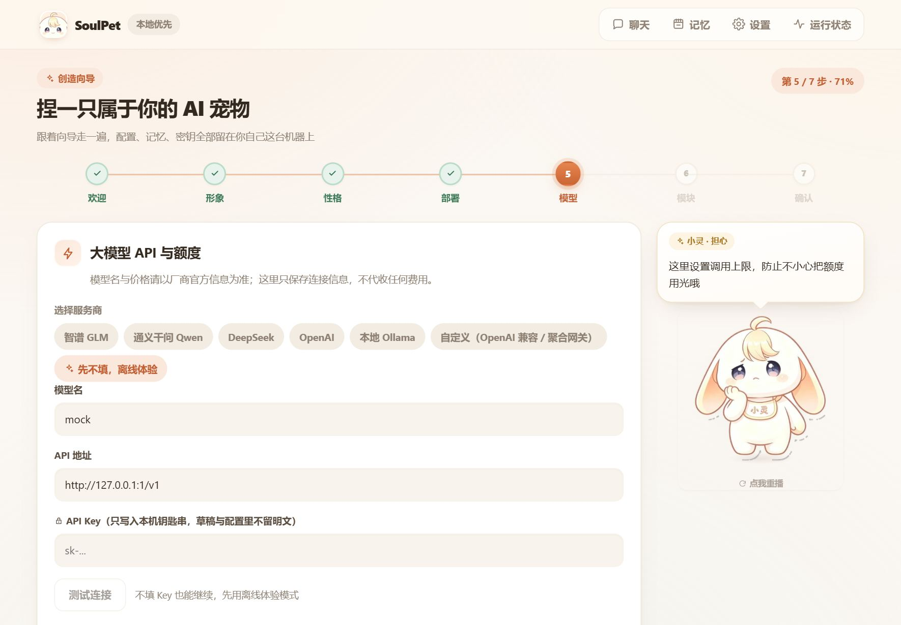
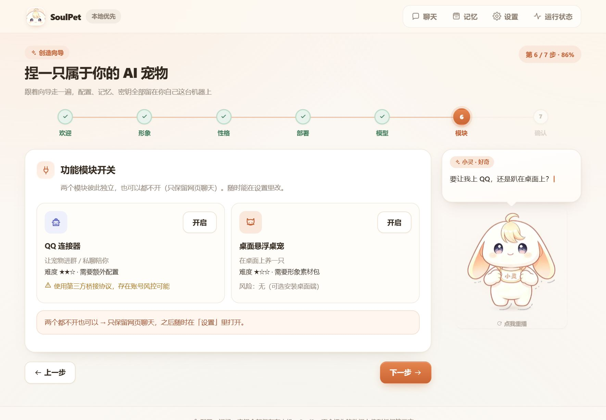
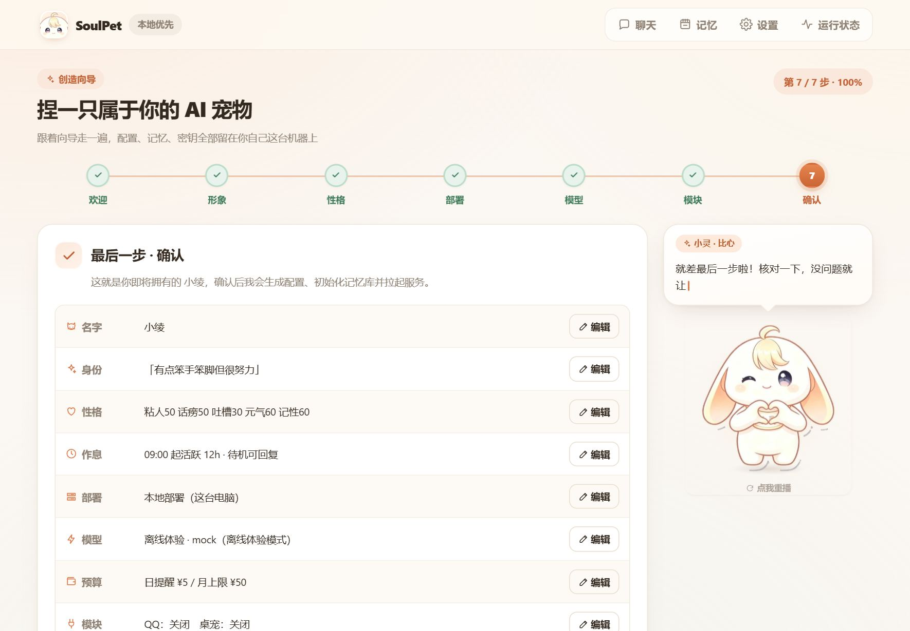
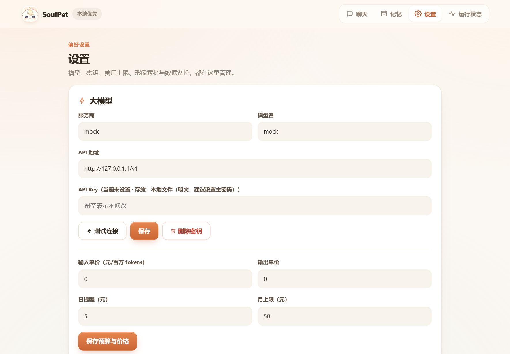
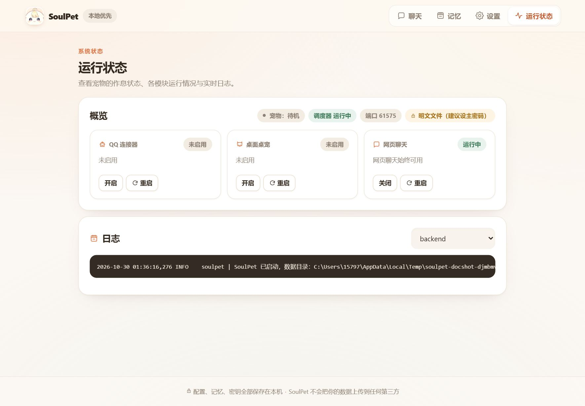

# SoulPet 使用手册

> 面向使用者的完整操作说明。照着做就能从零跑起来，不需要懂编程。
>
> 遇到问题先看 [第 11 章 故障排查](#11-故障排查)，绝大部分情况都能自己解决。

---

## 目录

1. [这是什么](#1-这是什么)
2. [装之前先确认](#2-装之前先确认)
3. [安装与第一次启动](#3-安装与第一次启动)
4. [捏宠九步，一步一图讲清](#4-捏宠九步一步一图讲清)
5. [日常使用：四个页面](#5-日常使用四个页面)
6. [大模型怎么填（逐家说明）](#6-大模型怎么填逐家说明)
7. [记忆是怎么工作的](#7-记忆是怎么工作的)
8. [接入 QQ](#8-接入-qq)
9. [桌面桌宠](#9-桌面桌宠)
10. [放到云服务器上](#10-放到云服务器上)
11. [故障排查](#11-故障排查)
12. [数据在哪 / 备份 / 迁移 / 卸载](#12-数据在哪--备份--迁移--卸载)
13. [环境变量与命令行参数](#13-环境变量与命令行参数)

---

## 1. 这是什么

SoulPet 是一只在你自己电脑上运行的 AI 宠物：

- 你在浏览器里点几步，就把它"捏"出来：起名字、定性格、配作息、接一个大模型。
- 之后你在网页里跟它聊天，它会记住你说过的事。
- **它的配置、记忆、API Key、形象素材，全部存在你这台机器的磁盘上**，本项目不运营任何服务器，也不收集任何数据。

唯一会联网的地方是你自己填的那个大模型 API 地址（以及你自己接的 QQ 通道）。不填 Key 也能用内置的「离线体验模式」把整套流程跑一遍。

它长这样：

| 创造向导 | 性格设置 |
|---|---|
|  |  |

| 聊天 | 记忆时间线 |
|---|---|
|  |  |

---

## 2. 装之前先确认

### 2.1 唯一必需的东西：Python 3.11 或更新

**怎么知道自己有没有？**

- **Windows**：按 `Win + R`，输入 `cmd` 回车，在黑窗口里敲：
  ```
  python --version
  ```
  看到 `Python 3.11.x` / `3.12.x` / `3.13.x` 之类就说明有了（3.11 以上都行）。
- **macOS**：打开「终端」，敲 `python3 --version`。
- **Linux**：终端里敲 `python3 --version`。

**没有的话怎么装？**

- Windows：到 <https://www.python.org/downloads/> 下载安装包，**安装第一屏务必勾选 `Add Python to PATH`**（这个勾不勾，后面全是麻烦）。
- macOS：`brew install python@3.12`，或同样去 python.org 下安装包。
- Linux（Debian/Ubuntu）：`sudo apt install python3 python3-venv python3-pip`

> 如果 `python --version` 打出来是 `3.10` 或更低，先升级。3.10 跑不起来。

### 2.2 磁盘和网络

- 磁盘：约 **200 MB**（依赖 ~40 MB + 前端 + 你的数据）。
- 首次启动需要联网装依赖；之后离线也能启动（只是聊天需要大模型联网）。

### 2.3 可选：一个大模型 API Key

没有也能用（离线体验模式会给你固定套路的回复），但想真正"有性格地聊天"，需要下面任意一家：

智谱 GLM / 通义千问 / DeepSeek / OpenAI / 本地 Ollama / 任意 OpenAI 兼容网关。

怎么弄见 [第 6 章](#6-大模型怎么填逐家说明)。

---

## 3. 安装与第一次启动

### 3.1 Windows

1. 把项目文件夹放到一个**路径不含中文和空格**的地方（比如 `D:\SoulPet`）。放 `C:\Program Files` 里会有权限问题。
2. 双击 **`start.bat`**。
3. 会弹出一个黑色窗口，依次看到：

   ```
     SoulPet - 你的私有 AI 宠物
     ----------------------------------------
     [1/4] Python 就绪
     [2/4] 首次运行，正在准备虚拟环境（约 1-3 分钟）...
     [3/4] 正在拉起服务，浏览器会自动弹出...
   ```

   第一次会久一点（在装依赖），**别关窗口**。
4. 浏览器自动打开 `http://127.0.0.1:8787`，看到欢迎页就成功了。

> **这个黑窗口就是服务本体，聊天的时候别关它。** 关了 = 宠物下线。

### 3.2 macOS / Linux

```bash
cd /你的路径/soulpet
chmod +x start.sh
./start.sh
```

看到 `[launcher] 打开浏览器：http://127.0.0.1:8787` 就好了。

### 3.3 浏览器没自动弹出来？

手动打开浏览器，地址栏输入：

```
http://127.0.0.1:8787
```

如果打不开，看黑窗口里打印的端口号——端口被占用时它会自动顺延：

```
[launcher] 端口 8787 被占用，改用 8788
```

那就访问 `http://127.0.0.1:8788`。

### 3.4 怎么关掉它

- **Windows**：双击 `stop.bat`，或直接关掉那个黑窗口。
- **macOS / Linux**：`./stop.sh`，或在这个终端里按 `Ctrl + C`。

### 3.5 下次再打开

还是双击 `start.bat` / `./start.sh`。这次不会再装依赖，几秒就起来，而且会直接跳到聊天页（因为已经捏好了）。

---

## 4. 捏宠九步，一步一图讲清

向导一共九步，但**不是每步都会出现**：开了 QQ 才会出现 QQ 配置，开了桌宠才会出现桌宠配置。页面右上角显示「第 X / N 步」。

页面右边那只兔子是「向导小灵」，一共 12 张立绘、9 种情绪（待命 / 开心 / 比心 / 欢呼 / 好奇 / 思考 / 担心 / 慌张 / 委屈），
会根据你当前在哪一步自动换台词和姿态，切换时是淡入淡出而不是硬切。**点它一下可以重播这句话**；
你填错了的时候它会换成慌张脸 + 头顶「!!」。小屏上它会缩到气泡右侧，不占正文空间。


### 步骤 1 · 欢迎

三句知情确认，**必须全部勾选**才能往下走：

1. 我理解配置与记忆保存在本机，我可以随时导出或删除 —— 说明数据在哪。
2. 我理解调用大模型会产生费用，费用由模型厂商收取，本程序不代收 —— 说明钱花给谁。
3. 我理解若启用 QQ 连接器，将使用第三方桥接协议，存在账号风控风险 —— 说明 QQ 那部分的风险。

没勾就点「下一步」会被拦住，并提示「先读完并勾选上面的三项知情确认」。

### 步骤 2 · 形象



| 填什么 | 说明 |
|---|---|
| **名字** | 最多 16 字。这是它的自称，会写进性格提示词。右边「随机」按钮可以帮你想一个。 |
| **身份预设** | 可多选：女仆 / 沉默NPC / 活泼搭子 / 清冷助手 / 毒舌猫系 / 温柔学长学姐。影响说话腔调。 |
| **自定义身份** | 想更具体就写一句，比如「说话带点口癖『主人~』」。会叠加在预设之上。 |
| **一句话简介** | 比如「有点笨手笨脚但很努力」。会进系统提示词，影响它的自我认知。 |
| **形象来源** | 目前内置一套 SVG 形象（不联网、不占空间）。选「自定义素材包」需要先有 zip（见 [9.3](#93-自己做一套形象素材)）。 |

> 名字是必填项。不填点下一步，小灵会慌：「还没有名字呢，给我起一个吧~」

### 步骤 3 · 性格与作息


**五个滑块（0–100）**，每个左边是"低"的表现，右边是"高"的表现：

| 滑块 | 拉到低 | 拉到高 | 它实际控制什么 |
|---|---|---|---|
| 粘人程度 | 高冷疏离 | 寸步不离 | 主动消息频率、句子里的依赖感 |
| 说话风格 | 惜字如金 | 话痨小作文 | 回复长度上限（`max_tokens`） |
| 吐槽频率 | 温柔体贴 | 句句带刺 | 采样温度、允许的刻薄程度 |
| 情绪倾向 | 阴郁低沉 | 元气满满 | 采样温度 + 情绪词选择 |
| 记忆偏好 | 金鱼记忆 | 过目不忘 | 记忆写入阈值、检索 TopK |

> 这些数字不是直接丢给模型，而是先映射成自然语言描述 + 采样参数。映射表在 `backend/core/prompt_builder.py`，懂代码可以自己改。温度上限被压在 0.95，避免说话发散到不像人。

**性格标签（可多选）**：傲娇 / 天然呆 / 姐系 / 弟系 / 中二 / 毒舌 / 温柔 / 好奇宝宝 / 社恐 / 话痨。会作为额外风格词加进提示词。

**作息**：

- **活跃开始时间**：`HH:MM` 格式，比如 `08:30`。**格式不对会被拦下**（试 `25:99` 会被拒）。
- **活跃时长**：1–24 小时。超出范围会被拦。
- 活跃时段之外它进入「待机」状态；待机时你发消息它也会回（用「待机可回复」开关控制）。
- 默认 12 小时活跃 + 12 小时待机。

**主动消息**：开关 + 每天最多几条（默认 3）+ 免打扰时段（默认 23:00–08:00，两个时间点都要填，格式 HH:MM）。

**红线规则**：可以加多条，比如「不许主动提工作压力」。每条都会作为硬约束写进每轮提示词。

### 步骤 4 · 部署载体



| 选项 | 什么时候选 |
|---|---|
| **本地部署（这台电脑）** | 99% 的情况选这个。关机就下线，但数据全在自己手里。 |
| **云服务器** | 想让它 7×24 在线。需要你已经有服务器，并填主机/端口/用户/目录。**向导只写配置，不会去动你的服务器**，具体部署见 [第 10 章](#10-放到云服务器上)。 |

> 选「云服务器」之后，「桌面桌宠」会自动关掉并在模块页置灰——服务器没有屏幕，开桌宠没有意义。

### 步骤 5 · 大模型 API 与额度



1. **选服务商**：点一下标签就把默认的 API 地址和模型名填好。
2. **模型名**：以厂商后台显示的为准，可以改。
3. **API 地址**：必须以 `http://` 或 `https://` 开头。
4. **API Key**：只写进本机钥匙串，草稿和配置文件里都不会留明文。
5. **测试连接**（可选）：填了 Key 之后点一下，会显示「连通 · 延迟 xxx ms · 模型 xxx」，或给出失败原因。

> **不想填 Key？** 点「先不填，离线体验」这一项，会用内置离线回复跑完全流程。之后在「设置 → 大模型」里补 Key 即可，不用重新捏。

**资源额度与上限**：

| 字段 | 说明 |
|---|---|
| 输入单价 / 输出单价（元 / 百万 tokens） | 按厂商官网价格填。**不填也能用**，只是费用统计不可用。 |
| 日消费提醒（元） | 超过就提醒你一下（默认 5）。 |
| 月消费上限（元） | 累计到这个数就进入「省钱待机」，不再自动调用模型（默认 50）。 |
| 达到月上限时自动进入省钱待机 | 建议开着，这是最后一道刹车。 |

### 步骤 6 · 功能模块开关



两个模块互相独立，也可以都不开（那就只有网页聊天）：

- **QQ 连接器**：让宠物进群 / 私聊。难度 ★★☆，需要另外部署 NapCat，且有账号风控风险。
- **桌面悬浮桌宠**：在桌面上养一只。难度 ★☆☆，需要形象素材包。云服务器模式下不可用。

开了对应的模块，后面就会多出对应的配置步骤。

### 步骤 7 · QQ 配置（只在开了 QQ 时出现）

三种方案，**难度和风险完全不同**：

| 方案 | 难度 | 性质 | 建议 |
|---|---|---|---|
| **NapCat / Lagrange** | ★★☆ | 第三方协议实现 | 推荐。生态成熟，只跟你自己部署的 NapCat 通信 |
| **官方开放平台机器人** | ★★★ | 腾讯官方，合规 | 要资质申请和审核，但风控最低 |
| **Lite 协议** | ★☆☆ | 非官方逆向协议 | **违反 QQ 用户协议**，可能限制账号。本项目不实现、不分发任何协议代码，只保留配置位 |

填什么：

- **NapCat 地址**：默认 `ws://127.0.0.1:3001`，必须以 `ws://` 或 `wss://` 开头。
- **Token**：NapCat 那边配的 access token，写进钥匙串。
- **群白名单**：**默认全部拒绝**，只有你加进去的群才会回复。每行一个群号。
- **触发模式**：`@ 才回`（默认）/ 关键词 / 全部回复。
- **私聊**：是否允许私聊 + 白名单。
- **风险确认**：必须勾，否则不能继续。

具体怎么装 NapCat 见 [第 8 章](#8-接入-qq)。

### 步骤 8 · 桌宠形象（只在开了桌宠时出现）

会检查素材包完整性——需要 9 个槽位的图（待机、开心、生气、困、吃、玩、说话、被摸、睡觉）。缺哪个会直接列出来。内置素材包是完整的，直接过。

还能调：缩放比例、是否总在最前、是否鼠标穿透、不透明度。

### 步骤 9 · 确认



一张汇总表，每行右边都有「编辑」可以跳回去改。确认无误后点「**确认生成，启动我的宠物**」。

它会依次：备份现有配置 → 写宠物档案 → 写部署配置 → 保存 Key → 写模块配置 → 初始化记忆库并写入第一条记忆（「YYYY-MM-DD 主人创造了我，给我取名叫「XXX」」） → 启动调度器 → 跳到聊天页。

> 本地部署的提醒会出现：「关机宠物就离线了。想长期在线可在设置里迁移到云服务器。」

---

## 5. 日常使用：四个页面

顶栏四个入口：**聊天 / 记忆 / 设置 / 运行状态**。

### 5.1 聊天


- 输入框里打字，**Enter 发送**，**Shift + Enter 换行**。
- 回复是流式的（一个字一个字出来），不是等半天蹦一整段。
- 顶部能看到宠物名和「在线」状态。
- 手机浏览器也能用，布局会自动收窄。

### 5.2 记忆


这是它的"小本本"。每张卡片显示：类型、时间、来源、内容、重要度、被想起过几次。

| 操作 | 效果 |
|---|---|
| **搜索** | 全文检索（走 SQLite FTS5），支持中文 |
| **类型筛选** | 事实 / 情感 / 偏好 / 事件 |
| **置顶** | 置顶的记忆每轮都会被带进上下文，不会被检索漏掉 |
| **编辑** | 改内容、改重要度。它记错了就在这里改 |
| **遗忘** | 单条删除 |
| **手动添加** | 主动告诉它一件事，不用等它自己抽 |
| **清空** | 全删（会二次确认） |

**来源标记**很重要：

- `你亲口说的` —— 从你的话里直接抽的
- `它推断的` —— 模型自己总结的，可靠性略低
- `你手动加的` —— 你自己录的，最可信

> 它的"记性"不是玄学。每轮对话后有个抽取器判断这句话值不值得记，疑问句和不含信息量的句子会被直接丢掉，重复内容会去重。详见 [第 7 章](#7-记忆是怎么工作的)。

### 5.3 设置



| 区块 | 能改什么 |
|---|---|
| **大模型** | 服务商、模型名、API 地址、API Key（留空表示不修改）、测试连接、删除密钥 |
| **预算与价格** | 输入/输出单价、日提醒、月上限 |
| **费用** | 今日 / 本月 / 累计花费，以及「未配置单价」「已达月上限」等状态提示 |
| **形象素材** | 上传 zip 素材包，查看已有包是否完整 |
| **备份与重置** | 立即备份 / 恢复出厂 |

> **API Key 那一行的括号会告诉你密钥存在哪**：`系统钥匙串` / `加密文件` / `本地文件（明文，建议设置主密码）`。看到第三种就说明你这台机器既没有可用钥匙串、也没设主密码，建议按 [13.1](#131-环境变量) 设一个 `SOULPET_MASTER_KEY`。

> **恢复出厂** 会真的删掉配置、记忆、聊天记录和已保存的密钥，但**动手之前会先自动打一个备份包**放在 `data/backups/`，后悔还能捞。

### 5.4 运行状态



- **概览**：宠物当前状态（活跃 / 待机 / 省钱待机）、调度器是否在跑、端口、密钥后端。
- **模块卡片**：每个模块的状态（运行中 / 未启用 / 出错）、详情、最近一次错误。可以直接**开启 / 关闭 / 重启**，不用重启整个程序。
- **日志**：选模块，看最近 80 行日志。出问题第一眼看这里。

---

## 6. 大模型怎么填（逐家说明）

进「设置 → 大模型」，或者重新捏宠时那一步。点服务商标签会自动填好地址和模型名。

### 6.1 智谱 GLM

- 地址：`https://open.bigmodel.cn/api/paas/v4`
- 模型：`glm-4-flash`（便宜、够用）或 `glm-4-plus`
- Key 申请：<https://open.bigmodel.cn/> → 控制台 → API Keys
- 国内直连，不需要代理。

### 6.2 通义千问 Qwen

- 地址：`https://dashscope.aliyuncs.com/compatible-mode/v1`
- 模型：`qwen-plus` / `qwen-turbo` / `qwen-max`
- Key 申请：<https://bailian.console.aliyun.com/> → API-KEY 管理
- 注意地址里的 `/compatible-mode/v1` 不能少。

### 6.3 DeepSeek

- 地址：`https://api.deepseek.com/v1`
- 模型：`deepseek-chat`
- Key 申请：<https://platform.deepseek.com/>
- 便宜，中文表现好，适合日常陪聊。

### 6.4 OpenAI

- 地址：`https://api.openai.com/v1`
- 模型：`gpt-4o-mini` / `gpt-4o`
- Key 申请：<https://platform.openai.com/api-keys>
- 国内需要代理。**代理软件开着的情况下，这里的地址要么指向代理，要么给程序设系统代理。**

### 6.5 本地 Ollama（完全离线，不花钱）

1. 装 Ollama：<https://ollama.com/>
2. 拉模型：`ollama pull qwen2.5:7b`
3. 确认服务在跑：`ollama list` 能列出模型。
4. 向导里选「本地 Ollama」，地址 `http://127.0.0.1:11434/v1`，模型 `qwen2.5:7b`，**API Key 随便填一个非空字符串**（Ollama 不校验，但本程序要求非空）。

> 7B 模型在普通笔记本上能跑，速度一般。显存够可以上 14B。

### 6.6 聚合网关 / 自建 one-api

- 地址填你网关的 `/v1` 结尾地址。
- 模型名填网关里配置的模型标识。
- Key 填网关发给你的令牌。

### 6.7 单价怎么填

厂商页面通常写「¥X / 百万 tokens」。直接把数字填进去：

- 输入单价 = 你发过去的 token 价格
- 输出单价 = 模型回复的 token 价格

**不填也没关系**，只是费用统计显示"不可用"。填了才会算钱、才会触发月上限刹车。

### 6.8 费用是怎么被拦住的

1. 每轮对话前后都记账（`usage_meter`）。
2. 累计到今天超过「日提醒」→ 状态页提示。
3. 累计到本月超过「月上限」→ 宠物进入「省钱待机」，不再自动调用模型；你仍然能看记忆、改配置。
4. 想恢复：要么等月初，要么在设置里把上限调高。

---

## 7. 记忆是怎么工作的

理解这套机制，你才知道它为什么"忘事"或"记错"。

### 7.1 三层记忆

| 层 | 存在哪 | 作用 |
|---|---|---|
| **工作记忆** | 当前会话的最近 N 轮消息 | 保证对话连贯。默认 20 轮，可在配置里调 |
| **事件记忆** | SQLite `memories` 表 + `data/memory/*.jsonl` | 长期事实、偏好、事件。带重要度、时间、来源 |
| **摘要** | 会话级别 | 长对话压缩成的概要，避免上下文爆掉 |

### 7.2 什么会被记住

每轮对话后，抽取器会给这句话打分，只有够格的才入库：

- ✅ 会被记：`我叫小林`、`我对花生过敏`、`我今天面试过了`、`我喜欢下雨天`
- ❌ 不会被记：`你好呀`、`你在吗`、`你觉得这个怎么样？`（疑问句直接丢）、单纯的情绪抒发

抽取器还会：

- 把「我的猫叫团子」这类事实规范化成一条 `fact`（重要度 0.6），「我喜欢下雨天」这类偏好记成 `preference`（0.7）
- 做去重，并丢掉被长句完整包含的短碎片
- 由模型自己给重要度评分（0.0–1.0），越重要越容易在以后被想起。捏宠时写的那条"创造了我"固定 1.0

### 7.3 回忆是怎么发生的

每轮对话前，按当前话题检索：

1. **置顶记忆**无条件带上，永远不会被漏掉
2. 全文检索（SQLite FTS5，中文可用）命中当前话题的
3. 最近 20 条也进候选池，保证上下文连贯

最终排序公式（`backend/core/memory_engine.py`）：

```
score = 0.5 × 检索相关度 + 0.3 × 重要度 + 0.2 × 时间衰减
```

所以：说话里提到过的 > 重要度高的 > 时间新的。取前 TopK 条塞进提示词，同时给它们记一次"被想起"。

所以在记忆页**置顶**某条，等于永远不让它忘。

### 7.4 它记错了怎么办

去记忆页，找到那条，点「编辑」改掉，或者点「遗忘」删掉。改完立刻生效，不用重启。

---

## 8. 接入 QQ

> ⚠️ **先把风险说清楚**：NapCat / Lagrange 这类方案走的是第三方协议实现，**不是腾讯官方授权**，存在账号被风控（限流、临时封禁）的可能。请用小号，别拿主号试。真要长期稳定，走官方开放平台。

只有网页聊天 + QQ 都开着，宠物的"人格"才是同一只（共用同一份配置和记忆库）。

### 8.1 NapCat 路线（推荐）

**第 1 步：装 NapCat**

最简单的方式是用它官方的 Docker 镜像，或者 Windows 一键包。装完启动，扫码登录你要用的 QQ 号。

**第 2 步：开 WebSocket 服务端**

在 NapCat 的配置里启用「WebSocket 服务端」，记下：

- 端口：默认 `3001`
- Access Token：自己设一个字符串（别留空）

**第 3 步：回到 SoulPet 填**

向导第 7 步（或设置页）：

- 地址：`ws://127.0.0.1:3001`
- Token：刚才设的那个
- 群白名单：填群号，一行一个
- 触发模式：先选「@ 才回」最稳

**第 4 步：验证**

去运行状态页，QQ 连接器那栏应该变成「运行中」，详情里能看到心跳时间。然后到群里 @ 它试试。

### 8.2 官方开放平台路线

1. 到 <https://q.qq.com/> 注册开发者，创建机器人应用。
2. 拿到 `AppID` 和 `AppSecret`。
3. 在向导里选「官方开放平台机器人」，填 AppID / AppSecret。
4. 按平台要求配置回调地址和 IP 白名单（本项目会起一个接收端，端口就是你的服务端口）。
5. 提交审核。**这一步有审核周期，别指望当天能用。**

> 官方路线的能力和频率受限较多，但合规性最好。

### 8.3 内置的五道风控闸门

不管你选哪个方案，代码里都硬性拦着：

| 闸门 | 默认行为 |
|---|---|
| 群白名单 | **默认全部拒绝**，没配的群一律不回 |
| 私聊白名单 | 默认只回白名单里的人 |
| 触发模式 | 默认 `@ 才回`，不 @ 不插嘴 |
| 频控 | 单群 3 秒最多 1 条，全局 1 小时最多 200 条 |
| 熔断 | 连续失败 5 次，自动停 15 分钟 |

想立刻断开：运行状态页 → QQ 连接器 → 关闭（或设置页里的一键断开）。

### 8.4 QQ 常见错误

| 现象 | 原因 | 处理 |
|---|---|---|
| 一直「等待中」 | NapCat 没起，或端口不对 | 浏览器访问 `http://127.0.0.1:3001` 看有没有响应 |
| 连上了但群里不回 | 群号没进白名单，或者没 @ 它 | 检查白名单 + 触发模式 |
| 报 401 / token 错误 | Token 不一致 | 两边对齐 |
| 频繁断线 | 触发风控 | 降低频率，换小号，或改走官方路线 |

---

## 9. 桌面桌宠

> 当前版本：**桌宠的后端能力已就绪**（插件式模块、素材包校验、事件流 `/api/status/events`），独立的桌面客户端（Tauri 应用）还在路线图上，尚未随本版本提供。

### 9.1 现在能做什么

- 在向导里开启桌宠模块、选素材包、调缩放/置顶/穿透/透明度。
- 校验素材包完整性（9 个槽位）。
- 后端会通过 SSE 事件流推送宠物状态（活跃/待机、情绪变化），供桌面端订阅。

### 9.2 当前限制

- 运行状态页里桌宠模块会显示「未启用 / 缺少桌面端」——这是正常的，不是坏了。
- 云服务器模式下该模块会被强制禁用。

### 9.3 自己做一套形象素材

准备一个 zip，结构如下：

```
manifest.json
idle.png  happy.png  angry.png  sleepy.png  eat.png
play.png  talk.png  pat.png  sleep.png
```

`manifest.json`：

```json
{
  "id": "my_pack",
  "name": "我的小猫",
  "author": "你",
  "slots": {
    "idle": "idle.png",
    "happy": "happy.png",
    "angry": "angry.png",
    "sleepy": "sleepy.png",
    "eat": "eat.png",
    "play": "play.png",
    "talk": "talk.png",
    "pat": "pat.png",
    "sleep": "sleep.png"
  }
}
```

要求：

- 图片必须是 **PNG**（上传时会校验文件头，改后缀名骗不过去）
- 建议 512×512 或 1024×1024，正方形，透明背景
- 9 个槽位缺一个都不算完整，设置页会明确告诉你缺哪个

打包成 zip（**不要在 zip 里再套一层文件夹**），到「设置 → 形象素材」上传。

---

## 10. 放到云服务器上

适合"想让它 7×24 在线"的场景。前提：你有一台 Linux 服务器（1 核 1G 起），会基本的 SSH 操作。

### 10.1 一键起容器

```bash
cd deploy
cp .env.example .env
vim .env          # 至少改 SOULPET_MASTER_KEY 和 SOULPET_ACCESS_TOKEN
docker compose up -d
```

`.env` 里必须改的两项：

| 变量 | 说明 |
|---|---|
| `SOULPET_MASTER_KEY` | 密钥加密的主密码。**换了它，已存的 API Key 就解不开了**，请记牢 |
| `SOULPET_ACCESS_TOKEN` | 网页访问口令。不设的话，任何知道 IP 的人都能看你的记忆 |

### 10.2 访问口令怎么用

服务放到公网之后，**所有 `/api/*` 都会被拦**，必须带口令。

第一次登录，在浏览器打开：

```
http://你的域名或IP/?token=你在.env里设的口令
```

会自动换成一个 Cookie，然后把地址栏里的口令抹掉。之后正常访问就行，30 天内不用再输。

程序调用则用请求头：

```
Authorization: Bearer 你在.env里设的口令
```

> 你设的 `SOULPET_ACCESS_TOKEN` 如果一直没动过，请务必改成随机长字符串。`openssl rand -base64 24` 可以生成一个。

> 口令文件在 `data/access_token.txt`（权限 600）。如果你没设环境变量但开了云服模式，程序会自动生成一个写进去，并打在日志里。

### 10.3 域名与 HTTPS

`.env` 里再填：

```
DOMAIN=pet.example.com
EMAIL=you@example.com
```

Nginx 会自动去签 Let's Encrypt 证书。**记得在云厂商控制台放行 80 和 443 端口。**

没域名就用自签证书，浏览器会红着提示不安全——能用，但别在公共网络上这么干。

### 10.4 容器里的数据

`docker-compose.yml` 已经把这些目录挂出来了，删容器不丢数据：

```
./config  →  配置
./data    →  数据库、记忆、日志、备份、密钥
```

### 10.5 云服上的注意事项

- 本项目**不会**自动去动你的服务器。向导里填的云主机信息只是记录下来，实际部署是你自己执行上面的命令。
- **NapCat 的 WebSocket 端口绝对不能暴露到公网。** Docker 里要写成 `127.0.0.1:3001:3001`，别写成 `3001:3001`。
- 容器只监听回环，靠 Nginx 反代对外，所以别去改 compose 里的绑定地址。

---

## 11. 故障排查

### 11.1 浏览器一片白

1. 先按 `F12` 打开开发者工具，看 Console 有没有红色报错。
2. 如果是 **`Failed to load module script` / MIME type 是 text/plain**：这台 Windows 的注册表把 `.js` 映射错了。本项目已在服务端强制修正（`backend/main.py` 里 `mimetypes.add_type`），如果还出现，请确认你用的是 `start.bat` 而不是别的启动方式。
3. 如果提示「前端尚未构建」：执行
   ```bash
   cd frontend && npm install && npm run build
   ```
   （正式发布包里 `frontend/dist` 是已经带上的，一般不需要。）

### 11.2 打不开 127.0.0.1:8787

| 检查 | 怎么做 |
|---|---|
| 黑窗口还在吗 | 关了就重新 `start.bat` |
| 端口是不是变了 | 看黑窗口里的 `改用 87xx` |
| 防火墙拦了吗 | Windows 首次运行会弹"是否允许网络访问"，选允许（本地访问其实不需要，但放行更稳） |
| 服务真的起来了吗 | 浏览器访问 `http://127.0.0.1:8787/healthz`，应该返回一段 JSON |

### 11.3 聊天没反应 / 一直「…」

1. 去看**运行状态 → 日志**，选 `backend`，看最后几十行。
2. 常见原因：
   - **API Key 没填 / 填错** → 日志里会有 401 或 "unauthorized"
   - **地址写错** → 会有连接超时
   - **额度超了** → 状态会变成「省钱待机」，去设置里调高上限
   - **网络不通**（OpenAI 需要代理）
3. 最快的验证方式：设置页点「测试连接」，它会直接告诉你通不通、延迟多少。

### 11.4 它记不住我说的话

- 那句话本身可能"不值得记"（比如纯寒暄）。判断逻辑见 [7.2](#72-什么会被记住)。
- 记性滑块拉太低 → 检索门槛高。去性格页把「记忆偏好」拉高。
- 已经记了但没检索出来 → 去记忆页**置顶**它。

### 11.5 提示"需要访问口令"

说明你开着云服模式（或设了 `SOULPET_ACCESS_TOKEN`）。在地址后加 `?token=你的口令` 登录一次即可。

忘记口令了？本地打开 `data/access_token.txt` 看，或者直接改 `.env` / 环境变量后重启。

### 11.6 重启后宠物没了

正常情况下不会。如果真发生了：

1. 看 `config/` 目录里还有没有 `pet.profile.yaml`。
2. 如果没有，去 `data/backups/` 找最近的备份 zip，解压后把 `config/` 覆盖回去。
3. 备份是每次「确认生成」「恢复出厂」前自动打的。

### 11.7 端口一直被占用

```bash
# Windows
netstat -ano | findstr :8787
taskkill /PID <上面查到的PID> /F

# macOS / Linux
lsof -i :8787
kill -9 <PID>
```

或者干脆换端口：`start.bat --port 9000`。

### 11.8 怎么把日志给我看

日志在 `data/logs/backend.log`（自动轮转，单文件 10MB，保留 5 份）。运行状态页也能直接看。提 issue 时把最后 50 行贴上，比截图有用。

---

## 12. 数据在哪 / 备份 / 迁移 / 卸载

### 12.1 全部数据都在这里

```
soulpet/
├─ config/                  ← 你的全部设置（YAML，可以手改）
│  ├─ global.yaml           实例信息、端口、知情确认
│  ├─ pet.profile.yaml      名字、身份、性格、红线规则
│  ├─ schedule.yaml         作息、主动消息
│  ├─ deploy.yaml           本地/云端
│  ├─ model.yaml            模型、价格、预算
│  ├─ modules.yaml          模块开关、桌宠参数
│  ├─ qq.yaml               QQ 连接与白名单
│  └─ pricing.yaml          价格表
└─ data/                    ← 你的全部数据（已在 .gitignore 里，不会被提交）
   ├─ soulpet.db            数据库（宠物、会话、消息、记忆、用量）
   ├─ soulpet.db-wal        WAL 日志（SQLite 的正常文件，别手删）
   ├─ memory/events-YYYY-MM.jsonl  记忆的 JSONL 备份，按月份一个文件，人可读
   ├─ assets/packs/         形象素材包
   ├─ logs/backend.log      运行日志
   ├─ backups/*.zip         备份包
   ├─ secrets.enc           密钥加密文件（只在没有系统钥匙串时存在）
   └─ access_token.txt      云服访问口令
```

> **`config/*.yaml` 里没有明文密钥**。Key 存在系统钥匙串（Windows 凭据管理器 / macOS 钥匙串 / Linux Secret Service）里，配置里只留一个引用字符串。

### 12.2 备份

**方法一（推荐）**：设置页 → 「立即备份」，会在 `data/backups/` 生成 `soulpet-backup-YYYYMMDD-HHMMSS.zip`，包含 config + 数据库快照 + 记忆。

> 数据库是用 SQLite 的在线备份接口取的一致性快照，不是硬拷文件——所以即使服务正在跑，备份也是完整的。

**方法二（手动）**：直接复制 `config/` 和 `data/` 两个目录。**先关掉服务再拷**，否则数据库可能拷到一半。

### 12.3 换电脑

1. 旧机器：设置页 → 立即备份，或手动拷 `config/` + `data/`。
2. 新机器：装好 Python，把项目放好，**先启动一次**让它建好目录结构，然后关掉。
3. 把备份解压，`config/` 和 `data/` 覆盖到新机器对应位置。
4. 重新启动。

> **API Key 不会跟着 zip 走**（它在你旧机器的系统钥匙串里）。新机器上需要去设置页重填一次 Key。

### 12.4 导出记忆

记忆同时以 JSONL 形式写在 `data/memory/events-YYYY-MM.jsonl`，一行一条，纯文本，可以直接打开看或用脚本处理。

### 12.5 卸载

1. 关掉服务（`stop.bat` / `./stop.sh`）。
2. 删掉整个项目文件夹。
3. 想彻底不留痕，再清一下系统钥匙串里的 `soulpet` 条目：
   - Windows：控制面板 → 凭据管理器 → Windows 凭据 → 找 `soulpet`
   - macOS：钥匙串访问 → 搜索 `soulpet`

---

## 13. 环境变量与命令行参数

### 13.1 环境变量

| 变量 | 作用 | 默认 |
|---|---|---|
| `SOULPET_HOME` | 数据根目录。想让数据和代码分开，或者同时跑两个实例，就设它 | 项目根目录 |
| `SOULPET_MASTER_KEY` | 密钥加密主密码。**Linux 无图形环境必设**，否则密钥只能明文存 | 空 |
| `SOULPET_SECRET_BACKEND` | 设为 `file` 时强制只用加密文件，不碰系统钥匙串（CI / 容器用） | 空（优先钥匙串） |
| `SOULPET_SECRET_LLM_API_KEY` | 用环境变量直接注入模型 Key，优先级最高 | 空 |
| `SOULPET_SECRET_QQ_TOKEN` | 同上，注入 QQ token | 空 |
| `SOULPET_ACCESS_TOKEN` | 网页访问口令。公网部署必设 | 空（不启用） |
| `SOULPET_CORS_ORIGINS` | 允许跨域的前端地址，逗号分隔。只用默认前端就不用管 | 本地几个端口 |

**Windows 临时设（当前这个黑窗口有效）：**

```bat
set SOULPET_MASTER_KEY=你自己想的密码
start.bat
```

**Windows 永久设：**

```bat
setx SOULPET_MASTER_KEY "你自己想的密码"
```
（新开的窗口才生效）

**macOS / Linux：**

```bash
export SOULPET_MASTER_KEY="你自己想的密码"
./start.sh
```

### 13.2 命令行参数

```bash
python launcher/launcher.py [参数]
```

| 参数 | 说明 |
|---|---|
| `--port 8787` | 指定端口。被占用时仍会自动往后找 |
| `--host 127.0.0.1` | 监听地址。**改成 `0.0.0.0` 就等于对外开放，必须同时设 `SOULPET_ACCESS_TOKEN`** |
| `--no-browser` | 不自动开浏览器（服务器上用） |
| `--reload` | 开发模式，改代码自动重启（别在生产用） |

`start.bat` / `start.sh` 会把参数透传过去，所以也可以 `start.bat --port 9000`。

### 13.3 接口文档

服务跑起来时，浏览器访问：

```
http://127.0.0.1:8787/api/docs
```

能看到全部接口、参数、返回结构，还能直接在页面上试。想写脚本自动化的话从这里开始。

---

## 附：一分钟上手清单

- [ ] 确认 `python --version` ≥ 3.11
- [ ] 把项目放在不含中文和空格的路径
- [ ] 双击 `start.bat`（macOS/Linux 用 `./start.sh`）
- [ ] 浏览器自动打开 → 欢迎页勾三项
- [ ] 起名字 → 拖性格滑块 → 选"本地部署"
- [ ] 模型页：有 Key 就填，没有就点"先不填，离线体验"
- [ ] 模块页：先都关着，以后想加再加
- [ ] 确认页点"确认生成，启动我的宠物"
- [ ] 在聊天页打声招呼

有问题先看 [11 故障排查](#11-故障排查)，还搞不定就看 `data/logs/backend.log`。
